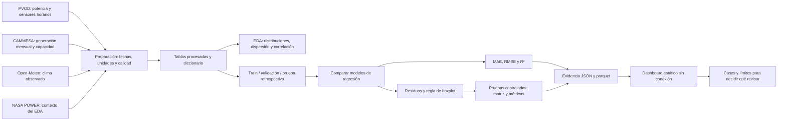

# Arquitectura de la solución

Clases 2 y 4: pipeline ETL y CRISP-DM. El diagrama representa el flujo que ejecutan los notebooks y la aplicación.

## Contrato de ejecución

1. `01_descarga` / `python -m src.build_datasets`: extrae las fuentes faltantes a `data/raw/`, transforma y guarda en `data/processed/`.
2. `02_eda`: inspecciona fuentes, calidad y asociaciones; no cambia las observaciones para fabricar resultados.
3. `03_modelos` / `python -m src.academico`: ajusta modelos y selecciona con validación. Calcula la calibración, escenarios y evidencia de China y Argentina.
4. `04_deteccion` y `05_negocio`: interpretan la evidencia generada; muestran matrices, casos y límites.
5. `python app/build_dashboard.py`: verifica el contrato y empaqueta JSON como JavaScript local. No vuelve a entrenar ni modifica cifras.
6. `app/index.html`: representa esos resultados con Plotly y recursos locales. No consulta APIs.

## Diferencias que deben mantenerse

- China: target potencia normalizada horario; agregación de energía diaria para alertas.
- Argentina: target factor de capacidad mensual; referencia histórica propia por parque.
- Las transformaciones se ajustan en entrenamiento. Los datos de selección y prueba no se usan para ajustar el modelo.
- Las caídas controladas se aplican después del ajuste. No son entrenamiento ni etiquetas reales de mantenimiento.
- La ausencia o invalidez se conserva hasta decidir cobertura diaria; eliminar una hora del ajuste no elimina su existencia del calendario de evaluación.
