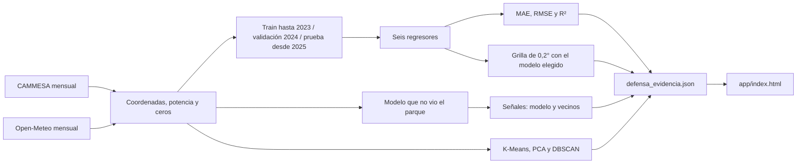

# Arquitectura

Clases 2 y 4: del archivo mensual al dashboard, sin red en la defensa.

## Contrato

1. `python -m src.academico` entrena, arma la grilla y las señales, y escribe la evidencia argentina.
2. `python app/build_dashboard.py` copia la evidencia a `app/datos.js`. No vuelve a entrenar.
3. `app/index.html` muestra A revisar, Sitio nuevo, Modelos y Datos. La consulta de un sitio lee la grilla.

El identificador del parque no es una entrada del modelo. La energía en GWh se calcula en la página a partir del factor, la potencia y las horas del mes.
